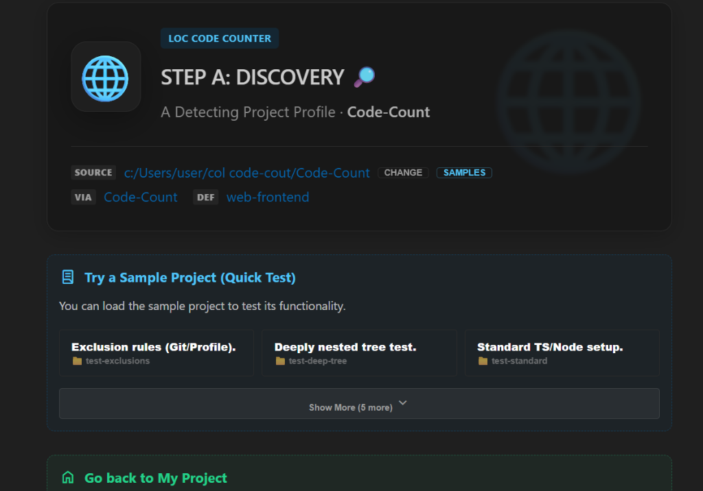
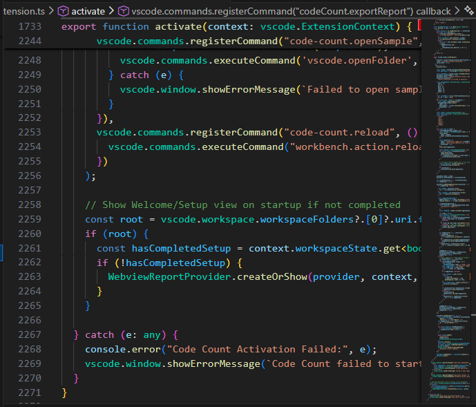
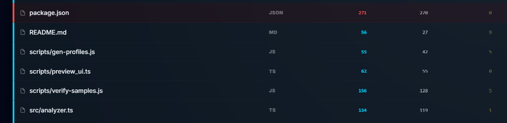
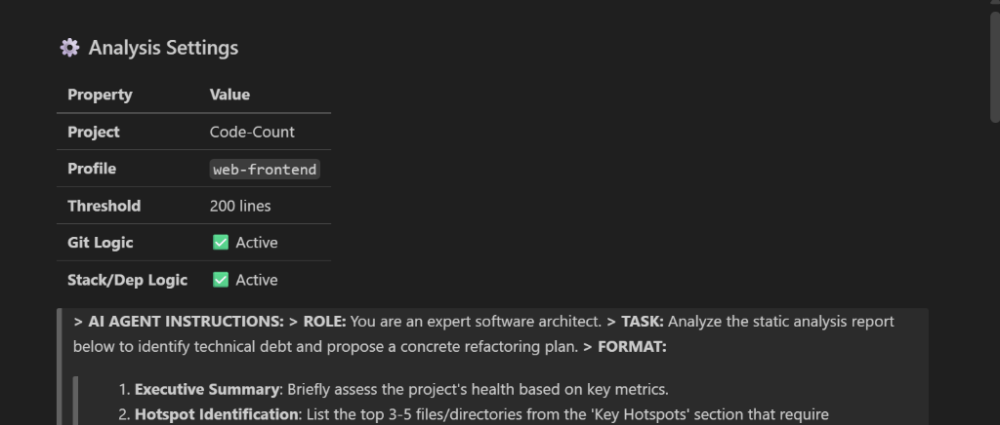
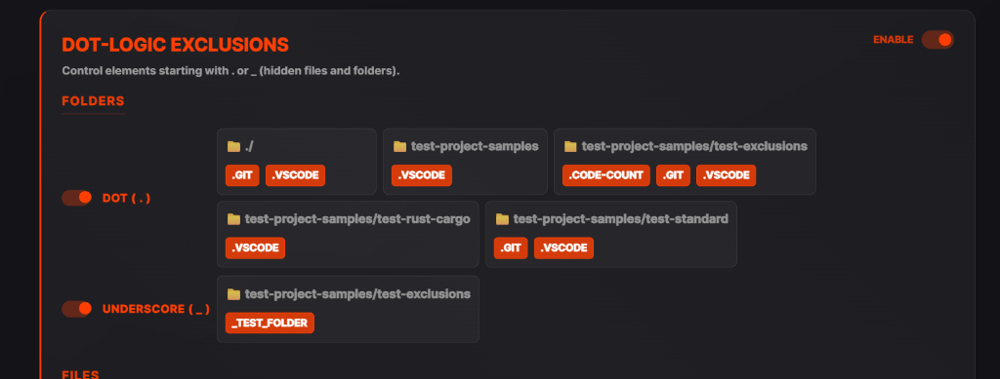
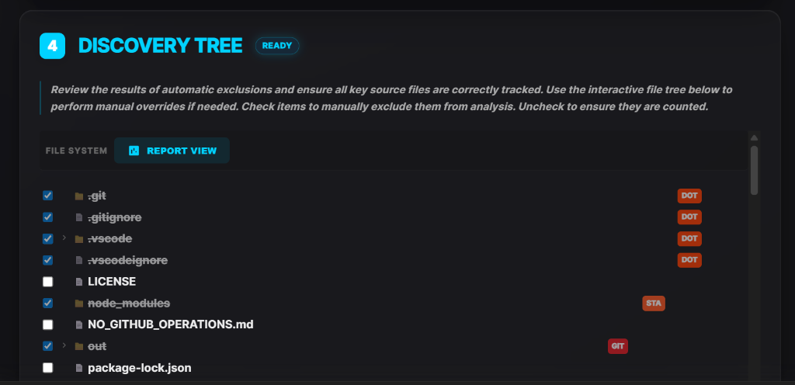

# COL Code Counter: AI-Ready Guard 🛡️

**Code Count** is a VS Code extension designed for the modern AI-assisted development era. It monitors file line counts and import density to help you maintain modular, clean code that fits perfectly within AI context windows.

## 🚀 Why Code Count?

In the age of LLMs (Large Language Models), **context is everything**. Large, bloated files lead to:

- **AI Context Overflow**: Agents lose track of logic in files over 200-300 lines.
- **Hidden Complexity**: Excessive imports signal tight coupling and architectural debt.
- **Slower Refactoring**: Modular code is easier for both humans and AI to analyze and modify.

## ✨ Features

- **Prefix-Aligned Monitoring**: See exact line counts directly in the Explorer tree, perfectly aligned for easy scanning (e.g., `[ 150] file.ts`).

- **Workspace Summary Dashboard**: An at-a-glance dashboard at the top of the view showing Average, Maximum, and Minimum line counts across your active workspace.
- **Smart Progress Scanning**: Real-time progress reporting during heavy workspace scans to keep you informed of analysis status.
- **AI-Ready Warnings**: Automatically flags files exceeding configurable thresholds with a `!` warning badge to encourage immediate refactoring.
- **Global ON/OFF Toggle**: Easily pause the extension tracking with a single click in the view header.

## 🛠️ Usage

Once installed, a new view **"Code Count Monitor"** will appear in your Explorer activity bar.

### STEP B - Filter Settings

1.  **Monitor**: Keep an eye on the dashboard and individual file counts as you build.
2.  **Toggle**: Click the refresh or toggle icons in the view header to manage when the extension is active.
3.  **Refactor**: When a file shows a `!` badge, consider splitting that module.

## ⚙️ Settings

- `codeCount.enabled`: Globally enable or disable the file tracking feature (Default: true).
- `codeCount.threshold`: Maximum allowed lines per file before a warning badge appears (Default: 200). Use the settings slider to fine-tune.

- `codeCount.showImports`: Optionally display import counts in the tree item description (Default: false).

## 👨‍💻 Contributing

We welcome contributions!

1. Fork the repository.
2. Open in VS Code.
3. Press `F5` to start the Extension Development Host.
4. Submit a Pull Request.

## 🛡️ Maintenance & Refactoring

**CRITICAL for Contributors:**
When refactoring Webview code in `src/extension.ts`, be aware that the code is inside TypeScript template strings.

1. **Compiler Ignorance**: TypeScript does not check the logic inside Webviews. Errors will only appear at runtime.
2. **Grep Before Delete**: Always search for usages of a function before deleting it, as they may be called by other functions within the same string.
3. **HTML tag Balance**: Ensure closing tags are preserved when removing large UI blocks.

---

_Made with ❤️ for the AI-Agent Community._

